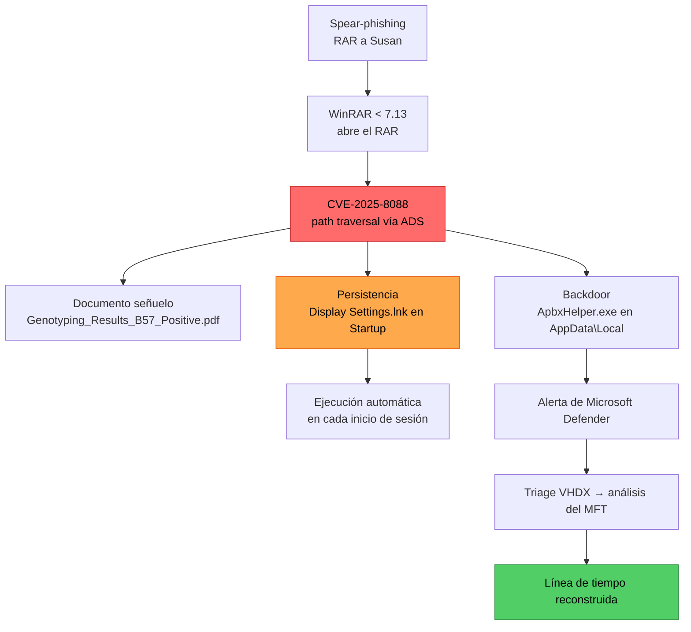

# RomCom — HackTheBox Sherlock Writeup

<p align="center">
  
  
  
  
</p>

> Investigación forense (DFIR) del incidente **RomCom** en el Hospital Internacional Forela. Un correo de spear-phishing entrega un RAR que explota **CVE-2025-8088 (WinRAR path traversal vía ADS)**, soltando un backdoor y persistencia en la carpeta Startup. La reconstrucción se hace sobre una **imagen de triage VHDX**, analizando el **`$MFT`** para armar la línea de tiempo exacta del ataque.

---

## 📑 Tabla de contenidos

- [Ficha del caso](#-ficha-del-caso)
- [Cadena del incidente](#-cadena-del-incidente)
- [1. Contexto del incidente](#1-contexto-del-incidente)
- [2. Inteligencia de amenazas (RomCom + CVE-2025-8088)](#2-inteligencia-de-amenazas-romcom--cve-2025-8088)
- [3. Preparación del entorno — montaje del VHDX](#3-preparación-del-entorno--montaje-del-vhdx)
- [4. Análisis forense del `$MFT`](#4-análisis-forense-del-mft)
- [5. Línea de tiempo del ataque](#5-línea-de-tiempo-del-ataque)
- [6. MITRE ATT&CK](#6-mitre-attck)
- [7. Hallazgos (Q&A del Sherlock)](#7-hallazgos-qa-del-sherlock)
- [8. Indicadores de compromiso (IOCs)](#8-indicadores-de-compromiso-iocs)
- [9. Recomendaciones de remediación](#9-recomendaciones-de-remediación)
- [Lecciones aprendidas](#-lecciones-aprendidas)

---

## 🎯 Ficha del caso

| Campo | Valor |
|---|---|
| **Sherlock** | RomCom |
| **Categoría** | DFIR — Respuesta a incidentes |
| **Plataforma** | HackTheBox Sherlock |
| **CVE investigado** | CVE-2025-8088 (WinRAR, path traversal vía ADS) |
| **Actor de amenaza** | RomCom APT (alineado con Rusia) |
| **Fecha del incidente** | 2025-09-02 |
| **Evidencia entregada** | `2025-09-02T083211_pathology_department_incidentalert.vhdx` (triage) |
| **Artefacto clave** | `$MFT` (Master File Table) |
| **SO de análisis** | Kali Linux |

---

## 🗺️ Cadena del incidente



> **Patrón RomCom:** ingeniería social + zero-day + persistencia silenciosa. El usuario ve solo un documento legítimo; el backdoor y la persistencia se instalan sin interacción adicional.

---

## 1. Contexto del incidente

Susan trabaja en el Laboratorio de Investigación del Hospital Internacional Forela. Su equipo generó una alerta en **Microsoft Defender**. Ella reportó que, al extraer un documento de un archivo recibido, aparecieron múltiples errores — aunque el documento se abrió con normalidad.

La inteligencia de amenazas más reciente indicaba que el grupo APT **RomCom** estaba explotando una vulnerabilidad en **WinRAR** para obtener acceso inicial a redes corporativas. WinRAR es una de las herramientas que usa el personal del hospital.

Se entregó una **imagen de triage forense** del disco de Susan para iniciar la investigación mientras el SOC barría el entorno.

> **VHDX:** formato de disco virtual de Microsoft (Virtual Hard Disk). Es como una "foto" de un disco real en un solo archivo. Para analizarlo hay que **montarlo** de forma que el sistema lo trate como un disco físico.

---

## 2. Inteligencia de amenazas (RomCom + CVE-2025-8088)

### ¿Quién es RomCom?

RomCom (también **Storm-0978**, **Tropical Scorpius** o **UNC2596**) es un grupo APT alineado con Rusia que combina espionaje y cibercrimen. Ha atacado sectores financiero, manufacturero, de defensa y logística en Europa y Canadá.

### CVE-2025-8088

Vulnerabilidad de **path traversal** en WinRAR `<= 7.12`, descubierta por ESET y parcheada en **WinRAR 7.13** el 30 de julio de 2025.

**Cómo funciona:** abusa de los **Alternate Data Streams (ADS)** de NTFS — una característica que permite adjuntar datos extra a un archivo. Un RAR malicioso puede:

1. Contener un documento aparentemente legítimo (el **señuelo**).
2. Llevar archivos maliciosos adjuntos como ADS al documento.
3. Al extraerse con un WinRAR vulnerable, los maliciosos se colocan en **directorios no elegidos por el usuario** — en concreto, la carpeta **Startup** de Windows.
4. Todo lo que esté en Startup se ejecuta **automáticamente** al iniciar sesión.

---

## 3. Preparación del entorno — montaje del VHDX

### 3.1 Extracción de la evidencia

```bash
# El ZIP de HTB viene protegido con la contraseña por defecto
unzip RomCom.zip
ls -la ~/Desktop/*.vhdx
```

### 3.2 Instalación de herramientas

```bash
sudo apt update
sudo apt install qemu-utils ntfs-3g -y
# qemu-nbd → montar el VHDX como disco de bloque
# ntfs-3g  → leer el sistema de archivos NTFS de Windows
```

### 3.3 Cargar el módulo NBD del kernel

```bash
sudo modprobe nbd max_part=8
lsmod | grep nbd
# nbd   65536  0
```

> `max_part=8` permite que cada dispositivo NBD tenga hasta 8 particiones, igual que un disco físico.

### 3.4 Montaje en **solo lectura**

```bash
# Conectar el VHDX como dispositivo de bloque
sudo qemu-nbd --connect=/dev/nbd0 ~/Desktop/2025-09-02T083211_pathology_department_incidentalert.vhdx
sleep 2

# Ver la estructura de particiones
sudo fdisk -l /dev/nbd0
```

```text
Disk /dev/nbd0: 507 MiB, 531628032 bytes, 1038336 sectors
Device      Boot  Start     End  Sectors   Size  Id  Type
/dev/nbd0p1 *        63  1038239  1038177  506.9M   7  HPFS/NTFS/exFAT
```

```bash
sudo mkdir -p /mnt/vhdx
# -o ro = READ ONLY: NUNCA modificar la evidencia original
sudo mount -t ntfs-3g /dev/nbd0p1 /mnt/vhdx -o ro
ls /mnt/vhdx
# 2025-09-02T08_32_11_5202830_CopyLog.csv
# C/
# System Volume Information/
```

> ⚖️ **Read-only es obligatorio.** Cualquier escritura contaminaría la evidencia y podría invalidarla en un proceso legal. Es el principio de **preservación** de DFIR.

### 3.5 Estructura del triage

No es una copia completa del disco, sino un **triage forense**. El directorio `C/` contiene solo dos artefactos críticos:

- **`$MFT`** — Master File Table: el índice maestro de todos los archivos del disco.
- **`$Extend/$J`** — USN Journal: el registro de cambios del sistema de archivos.

---

## 4. Análisis forense del `$MFT`

> **¿Qué es el MFT?** Es el catálogo de la "biblioteca" NTFS: un registro de **cada** archivo que ha existido en el disco — nombre, timestamps de creación/modificación/acceso, tamaño y ubicación. Es el artefacto forense más importante de Windows.

### 4.1 Instalación del parser

```bash
pip3 install mft --break-system-packages
python3 -c "import mft; print(dir(mft))"
# PyMftParser       - parser principal del MFT
# PyMftEntry        - cada entrada/archivo
# PyMftAttributeX10 - timestamps ($STANDARD_INFORMATION)
# PyMftAttributeX30 - nombre de archivo ($FILE_NAME)
```

> **Encoding:** el MFT usa **UTF-16 little-endian** (dos bytes por carácter). Por eso `strings` normal no sirve: hay que usar `strings -e l` o un parser especializado.

### 4.2 Metodología (4 fases)

| # | Fase | Objetivo |
|---|---|---|
| 01 | Búsqueda con `strings` | Extraer texto legible del MFT e identificar archivos de interés |
| 02 | Parseo con Python | Obtener timestamps precisos con `PyMftParser` |
| 03 | Resolución de rutas | Reconstruir rutas completas resolviendo IDs de directorio padre |
| 04 | Correlación temporal | Alinear eventos para reconstruir la línea de tiempo |

### 4.3 Búsqueda del RAR malicioso

```bash
strings -e l '/mnt/vhdx/C/$MFT' | grep -i '\.rar' | grep -v 'WinRAR\|unrar\|setup' | head -20
```

Timestamps precisos con el parser:

```python
# parse_mft.py
from mft import PyMftParser

parser = PyMftParser('/mnt/vhdx/C/$MFT')
for entry in parser.entries():
    try:
        for attr in entry.attributes():
            inner = attr.attribute_content
            if hasattr(inner, 'name') and 'Pathology' in str(inner.name):
                print(f'Name: {inner.name}')
                print(f'  Accessed: {inner.accessed}')
                print(f'  Created:  {inner.created}')
                print(f'  Modified: {inner.modified}')
    except Exception:
        pass
```

```text
Name: Pathology-Department-Research-Records.rar
  Created:  2025-09-02 08:13:50.440310+00:00
Name: Pathology-Department-Research-Records.lnk
  Created:  2025-09-02 08:14:04.996427+00:00
```

> **El `.lnk` revela cuándo se abrió el RAR.** Windows crea automáticamente un acceso directo en la carpeta `Recent` al abrir un archivo. La fecha de creación del `.lnk` es el momento exacto de apertura.

### 4.4 Artefactos en la ventana del ataque (08:13 – 08:20)

```python
# parse_mft.py — filtra por ventana temporal y descarta ruido del SO
from mft import PyMftParser
from datetime import datetime, timezone
import sys

parser = PyMftParser(sys.argv[1])
start = datetime(2025, 9, 2, 8, 13, 0, tzinfo=timezone.utc)
end   = datetime(2025, 9, 2, 8, 20, 0, tzinfo=timezone.utc)

seen = set()
for entry in parser.entries():
    try:
        for attr in entry.attributes():
            inner = attr.attribute_content
            if hasattr(inner, 'created') and inner.created and start <= inner.created <= end:
                name = str(getattr(inner, 'name', ''))
                skip = ['.js', '.css', '.manifest', '.log', '.db', '.json',
                        'DocumentCard', 'Edge', 'Chrome', 'leveldb', 'MANIFEST']
                if name and name not in seen and not any(x in name for x in skip):
                    seen.add(name)
                    print(f'{inner.created} | {name}')
    except Exception:
        pass
```

| Archivo | Timestamp (UTC) | Significado |
|---|---|---|
| `Pathology-Department-Research-Records.rar` | 08:13:50 | El RAR malicioso llega al disco |
| `Pathology-Department-Research-Records.lnk` | 08:14:04 | Susan abre el RAR con WinRAR |
| `Genotyping_Results_B57_Positive.pdf` | 08:14:18 | Documento señuelo extraído |
| `Display Settings.lnk` | 08:14:18 | Persistencia colocada en Startup |
| `ApbxHelper.exe` | 08:14:18 | Backdoor colocado por el exploit |
| `Genotyping_Results_B57_Positive.lnk` | 08:15:05 | Susan abre el PDF señuelo |

### 4.5 Resolución de rutas completas

El MFT no guarda rutas completas: cada archivo solo conoce el **ID del directorio padre**. Hay que resolver la cadena recursivamente hasta la raíz.

```python
# IDs de padre de cada archivo de interés
from mft import PyMftParser
parser = PyMftParser('/mnt/vhdx/C/$MFT')
targets = {'apbxhelper.exe', 'display settings.lnk', 'genotyping_results_b57_positive.pdf'}
for entry in parser.entries():
    try:
        for attr in entry.attributes():
            inner = attr.attribute_content
            if hasattr(inner, 'name') and str(inner.name).lower() in targets or \
               any(t in str(getattr(inner, 'name', '')).lower() for t in targets):
                print(f'{inner.name} -> parent {inner.parent_entry_id}')
    except Exception:
        pass
```

```text
Genotyping_Results_B57_Positive.pdf -> parent 104964
Display Settings.lnk                -> parent 115462
ApbxHelper.exe                      -> parent 104988
```

Resolviendo los IDs de padre recursivamente hasta la raíz:

| Archivo | Ruta completa reconstruida |
|---|---|
| PDF señuelo | `C:\Users\susan\Documents\Genotyping_Results_B57_Positive.pdf` |
| Backdoor | `C:\Users\susan\AppData\Local\ApbxHelper.exe` |
| Persistencia | `C:\Users\susan\AppData\Roaming\Microsoft\Windows\Start Menu\Programs\Startup\Display Settings.lnk` |

---

## 5. Línea de tiempo del ataque

| Hora (UTC) | Evento | Descripción |
|---|---|---|
| **08:13:50** | RAR llega al disco | `Pathology-Department-Research-Records.rar` se crea en `Documents`. Probablemente por correo. |
| **08:14:04** | Susan abre el RAR | WinRAR lo abre; Windows crea el `.lnk` en `Recent`. Comienza la explotación de CVE-2025-8088. |
| **08:14:05** | WinRAR extrae | Además del documento visible, extrae archivos maliciosos a ubicaciones no autorizadas. |
| **08:14:18** | Explotación completada | Tres artefactos simultáneos: PDF señuelo, backdoor `ApbxHelper.exe` y persistencia `Display Settings.lnk`. |
| **08:15:05** | Susan abre el PDF | Ve el señuelo y lo abre creyéndolo legítimo. El malware ya está instalado. |
| **08:15:29** | Alerta de Defender | Microsoft Defender detecta actividad sospechosa y genera la alerta en el SIEM. |

---

## 6. MITRE ATT&CK

### T1547.009 — Shortcut Modification

Subtécnica de *Boot or Logon Autostart Execution*. Los adversarios crean o modifican accesos directos `.lnk` para que apunten a malware y se ejecuten al iniciar sesión.

**¿Por qué T1547.009 y no T1547.001?**

| Subtécnica | Descripción |
|---|---|
| T1547.001 | *Registry Run Keys / Startup Folder* — pone **ejecutables** directamente en Startup o modifica claves Run del registro. |
| **T1547.009 ✓** | *Shortcut Modification* — la persistencia es específicamente un **acceso directo** (`Display Settings.lnk` en Startup) que apunta al backdoor `ApbxHelper.exe`. |

---

## 7. Hallazgos (Q&A del Sherlock)

| # | Pregunta | Respuesta / Evidencia |
|---|---|---|
| 1 | CVE explotado | CVE-2025-8088 — zero-day en WinRAR |
| 2 | Naturaleza de la vulnerabilidad | Path traversal vía Alternate Data Streams (ADS) en NTFS |
| 3 | Archivo RAR malicioso | `Pathology-Department-Research-Records.rar` |
| 4 | Creación del RAR en disco | 2025-09-02 08:13:50 UTC |
| 5 | Apertura del RAR | 2025-09-02 08:14:04 UTC (creación del `.lnk` en Recent) |
| 6 | Documento señuelo | `Genotyping_Results_B57_Positive.pdf` |
| 7 | Backdoor ejecutable | `C:\Users\susan\AppData\Local\ApbxHelper.exe` |
| 8 | Archivo de persistencia | `...\Startup\Display Settings.lnk` |
| 9 | Técnica MITRE | T1547.009 — Shortcut Modification |
| 10 | Apertura del PDF señuelo | 2025-09-02 08:15:05 UTC |

---

## 8. Indicadores de compromiso (IOCs)

**Archivos maliciosos**
```text
Pathology-Department-Research-Records.rar
ApbxHelper.exe
Display Settings.lnk
Genotyping_Results_B57_Positive.pdf   (documento señuelo)
```

**Rutas**
```text
C:\Users\susan\AppData\Local\ApbxHelper.exe
C:\Users\susan\AppData\Roaming\Microsoft\Windows\Start Menu\Programs\Startup\Display Settings.lnk
```

**CVE y versiones vulnerables**
```text
CVE-2025-8088  (WinRAR path traversal vía ADS)
WinRAR    <= 7.12
UnRAR.dll <= 7.12
```

---

## 9. Recomendaciones de remediación

| Prioridad | Acción |
|---|---|
| **Inmediato** | Aislar el equipo de Susan de la red corporativa |
| **Inmediato** | Eliminar `ApbxHelper.exe` de `C:\Users\susan\AppData\Local\` |
| **Inmediato** | Eliminar `Display Settings.lnk` de la carpeta Startup |
| **Urgente** | Actualizar WinRAR a **7.13+** en TODOS los equipos |
| **Urgente** | Barrido de IOCs (`ApbxHelper.exe`, `Display Settings.lnk`) en toda la red |
| **Corto plazo** | Revisar logs de red para identificar C2 del backdoor |
| **Corto plazo** | Capacitar al personal sobre archivos comprimidos recibidos por correo |
| **Largo plazo** | Política de actualización automática para software de terceros |

---

## 📚 Lecciones aprendidas

**El `$MFT` es el artefacto más valioso de Windows.** Contiene el historial completo de archivos, incluso de los eliminados.

**Los `.lnk` son oro forense.** Windows los crea automáticamente al abrir archivos, dando timestamps exactos de acceso.

**Siempre montar en read-only.** Cualquier escritura contamina la evidencia y puede hacerla inadmisible legalmente.

**El encoding importa.** El MFT es UTF-16 LE; sin `strings -e l` no se ven bien los nombres.

**Metodología DFIR aplicada:** Preservación → Identificación → Recolección → Análisis → Documentación → Reporte.

---

<p align="center">
  <sub>Investigación con fines <b>educativos</b>. Caso resuelto en el laboratorio legal y controlado de HackTheBox Sherlocks.</sub>
</p>